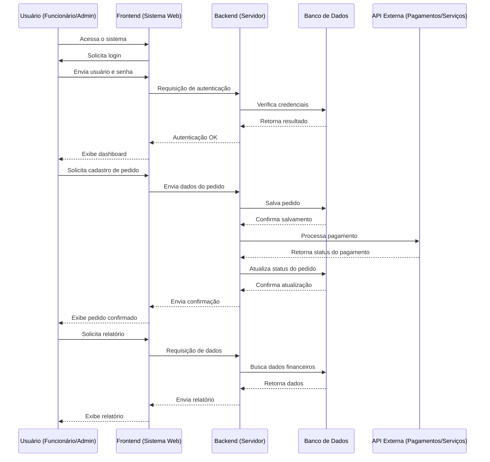

# 📊 Sistema Gestão Empresarial
## Resumo:
Sistema web para gestão de vendas, estoque e clientes, desenvolvido como projeto integrador do curso de Análise e Desenvolvimento de Sistemas.

### 🎯 Finalidade do Projeto
Este projeto tem como objetivo desenvolver um sistema de gestão empresarial (ERP) capaz de centralizar e otimizar os principais processos administrativos de uma empresa. A plataforma permite o controle integrado de pedidos, clientes, pagamentos e relatórios, proporcionando mais eficiência, organização e tomada de decisão baseada em dados.

A proposta é oferecer uma solução prática e acessível para digitalizar operações que muitas vezes ainda são feitas de forma manual ou descentralizada.

---

### 👥 Público-Alvo
O sistema é voltado para:

- 🏬 Pequenas e médias empresas (PMEs)  
- 👨‍💼 Empreendedores e gestores  
- 🧾 Setores administrativos e financeiros  
- 📦 Negócios que precisam gerenciar pedidos e operações  

---

### 🚀 Principais Benefícios
- Centralização das informações em um único sistema  
- Redução de erros operacionais  
- Automatização de processos (pedidos, pagamentos, relatórios)  
- Melhor controle financeiro e administrativo  
- Apoio na tomada de decisões estratégicas  

---

### 💡 Visão Geral
A plataforma foi pensada para ser intuitiva, eficiente e escalável, podendo ser adaptada para diferentes tipos de negócio. Além disso, busca aplicar boas práticas de desenvolvimento, organização de código e arquitetura de sistemas, servindo também como projeto de aprendizado e portfólio.

## Infraestrutura Técnica

### 🌐 Frontend Web


### 🗄️ Banco de Dados


## Diagrama de Sequência 

## Link
[Diagrama de Estado](https://raw.githubusercontent.com/LeonardoMartins08/sistema-gestao-empresarial/refs/heads/main/Engenharia%20de%20Software/diagrama-estado.md)

[Diagrama de sequência](https://raw.githubusercontent.com/LeonardoMartins08/sistema-gestao-empresarial/refs/heads/main/Engenharia%20de%20Software/Diagrama%20de%20Sequ%C3%AAncia.png)

[Caso de uso](github.com/LeonardoMartins08/sistema-gestao-empresarial/blob/main/Engenharia%20de%20Software/Caso%20de%20Uso.png?raw=true)

[Figma](https://www.figma.com/make/uHUuGhyVEp9BeUHooPYxQl/Loja-com-estoque-e-faturamento?p=f&t=ASkgMtrTasQzfoQn-0&fullscreen=1)
 - dashboard: Enzo Longo Bardo
 - estoque: Diego Favini Giacomo
 - Faturamento: Mateus de Freitas Martins


## 📌 Integrantes:

- Leonardo Martins
- Enzo Longo Bardo
- Mateus De Freitas Martis
- Diego Favini Giacomo

## Backend Python e banco SQLite

O back-end usa Flask. A biblioteca `sqlite3`, incluída no Python, cria e acessa o banco local `instance/erp.sqlite3`. O arquivo do banco é gerado na máquina e ignorado pelo Git; o esquema fica versionado em `database/schema_sqlite.sql`. Cadastro, login, logout e proteção de sessão são processados pelo Flask.

Para preparar o ambiente no PowerShell, na raiz do projeto:

```powershell
py -m venv .venv
.\.venv\Scripts\python.exe -m pip install -r requirements.txt
.\.venv\Scripts\python.exe -m flask --app app init-db
.\.venv\Scripts\python.exe -m flask --app app run --debug
```

O comando `init-db` cria as tabelas `usuarios` e `produtos` se ainda não existirem. `http://127.0.0.1:5000/health` informa se o Flask conseguiu consultar o SQLite. Acesse `/cadastro` para criar a primeira conta e `/login` para entrar; depois do login, o Flask abre o painel em `/`.

Na tela **Estoque**, o formulário de produto envia os dados para `POST /produtos/novo`. O Flask valida os campos e grava o produto com uma consulta parametrizada no SQLite. A lista abaixo do formulário consulta os produtos salvos e sinaliza quando a quantidade está no limite mínimo ou abaixo dele. Campos da tela correspondem à tabela `produtos`: nome, descrição, preço, quantidade e estoque mínimo.

No dashboard, os indicadores de produtos, unidades, valor estimado em estoque e necessidade de reposição são calculados a partir da tabela `produtos`. Os painéis de vendas e atividade recente exibem estados vazios até que existam tabelas e funcionalidades para registrar esses dados.

`database/Estrutura.sql` e `database/Usuarios.sql` são scripts da versão anterior com MySQL e não são usados pelo Flask. O esquema ativo é `database/schema_sqlite.sql`; o banco é o arquivo local `instance/erp.sqlite3`.

